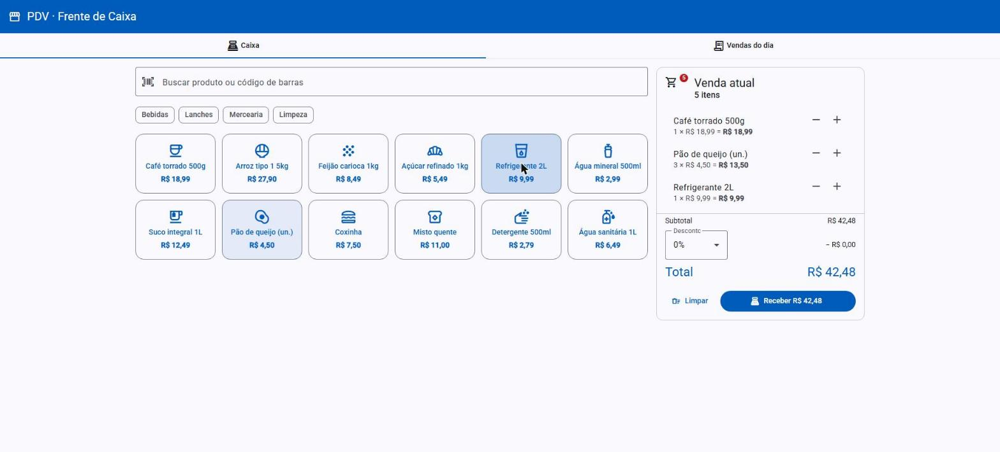
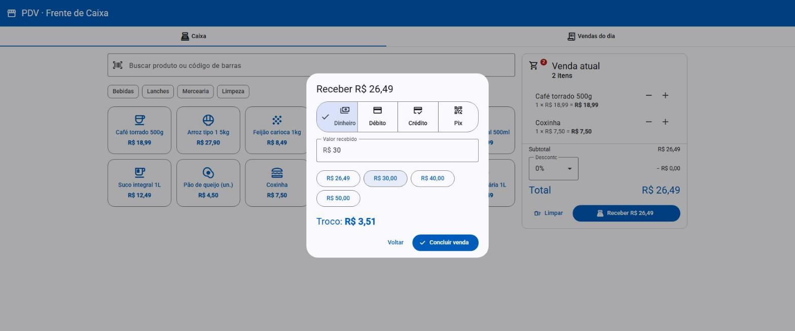
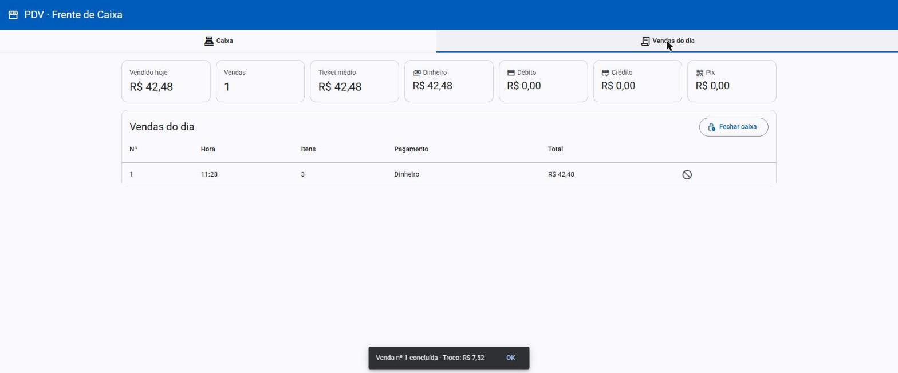

# PDV · Frente de Caixa (Angular)

> Projeto de portfólio: o módulo de ponto de venda de um mini-ERP de varejo.

Frente de caixa para mercearias e lanchonetes: catálogo por categoria, leitor de código de barras, carrinho, desconto com limite, pagamento em dinheiro (com troco), débito, crédito ou Pix, e o resumo de vendas do dia com cancelamento e fechamento de caixa.



## Stack

- **Angular 22**: componentes standalone, **signals** e `computed` para todo o estado, rotas com lazy loading, novo control flow (`@if`, `@for`).
- **Angular Material (Material 3)**: toolbar, abas, cards, chips, listas, diálogos, button toggles, snackbar, tabela.
- **Vitest** para os testes unitários.

## Decisões técnicas

- **Dinheiro em centavos (inteiros).** Nenhum cálculo usa ponto flutuante (`0.1 + 0.2 ≠ 0.3`). A formatação para R$ fica num pipe (`MoedaPipe`) com `Intl.NumberFormat`.
- **Regras no serviço, não na tela.** O `CaixaService` concentra carrinho, desconto (até 10% sem gerente), troco e resumo do dia. Os componentes só exibem e chamam métodos, o que deixa as regras testáveis sem renderizar nada.
- **Estado derivado com `computed`.** Subtotal, desconto, total e resumo por forma de pagamento são recalculados sozinhos, sem `subscribe` manual.
- **Pensado para o caixa:** atalho **F2** para receber, Enter no campo de busca para o leitor de código de barras, sugestão de notas para o troco (R$ 30, R$ 50…), e as vendas do dia ficam salvas no `localStorage` para sobreviver a um F5.

| Pagamento com troco | Vendas do dia |
|---|---|
|  |  |

## Como rodar

```bash
npm install
npm start          # http://localhost:4200
npm test           # testes do CaixaService
```

Códigos de barras para testar no campo de busca: `7891000100103` (café), `7894900011517` (refrigerante).

## Testes

`src/app/core/caixa.service.spec.ts` cobre:

- itens repetidos somando na mesma linha, e quantidade zero removendo o item;
- desconto arredondado em centavos e o limite de 10%;
- troco no dinheiro, recusa de valor insuficiente e de venda vazia;
- resumo do dia ignorando vendas canceladas e separado por forma de pagamento;
- persistência das vendas após recarregar a página.
